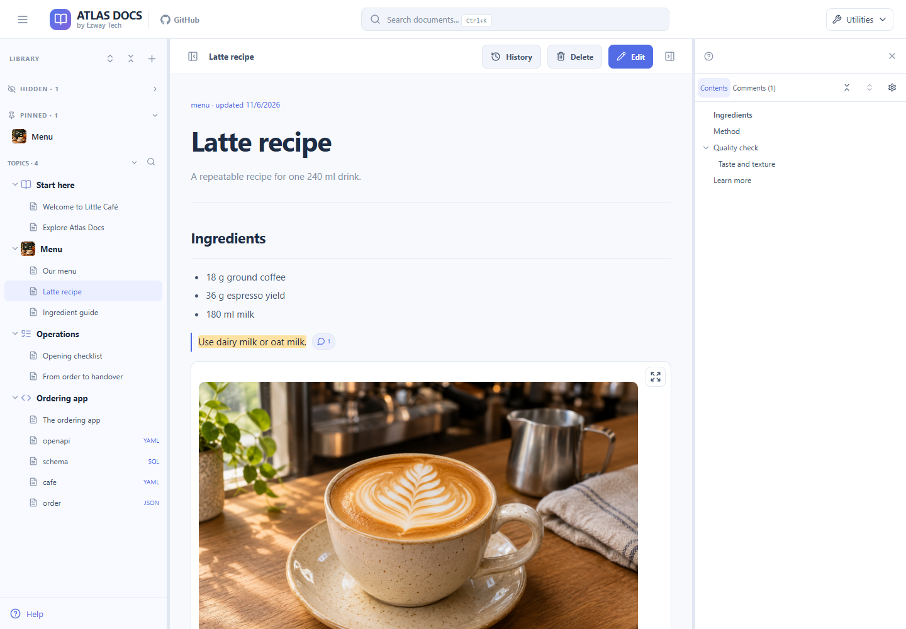
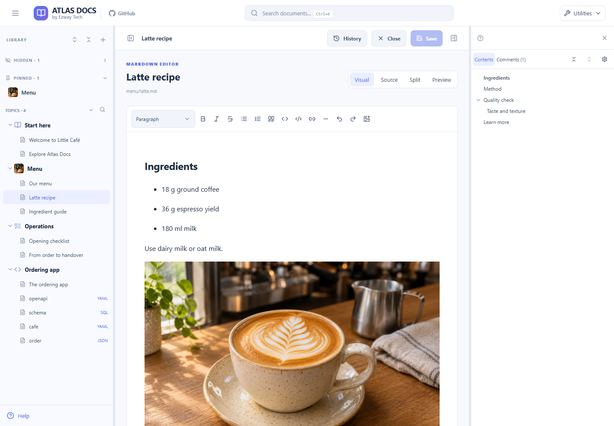
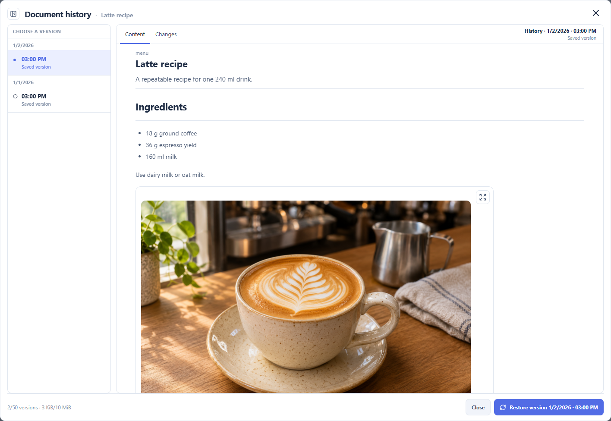

# Atlas Docs

**Keep your project docs organized, readable, and close to your code.**

Atlas Docs turns local Markdown, API definitions, and structured files into a browsable project library. Read, edit, search, and connect your documents in one workspace, with images, comments, and revision history alongside the content.

[Features](#features) · [Quick start](#quick-start) · [Documentation](#documentation)



*The optional Little Café sample library. New libraries start empty.*

## Why Atlas Docs?

For the published npm package, see [Atlas Docs with npm](guides/npm.md). For the Docker Hub image, see [Docker Hub image](guides/operations.md#docker-hub-image-end-users). The source-checkout instructions below remain available for development.

Project knowledge often spreads across setup notes, architecture documents, API specs, and database schemas. Atlas Docs gives those files a shared place to browse and maintain.

- **Find the context you need.** Browse by topic, follow related documents, or search across the library.
- **Make technical docs easier to read.** View diagrams, API endpoints, and SQL schemas alongside your written explanations.
- **Keep the files on your machine.** Store documents in a local directory and use Atlas Docs alongside your application repository.

## Features

### Organize once, find it again

Group documents into folders, pin frequent destinations, and jump through an article using its table of contents. Search documents, folders, and comments across the library or within one folder. Links between documents and incoming references help you follow the bigger picture.

### Read more than Markdown

Write explanations with Markdown tables, images, and Mermaid diagrams. Browse OpenAPI definitions with a dedicated endpoint viewer and SQL schemas with a schema viewer. Keep YAML and JSON reference files in the same library, with source views for the details.

### Write in the mode that fits

Use **Visual** for simple prose, **Source** for direct Markdown editing, **Split** to write beside the rendered result, or **Preview** to inspect your draft.



*Editing a document in the Little Café sample library.*

For complex Markdown, such as tables or Mermaid, Visual mode is disabled to protect the syntax. Use Source, Split, or Preview instead. Structured files use source editing and their corresponding view.

### Keep supporting material close

Upload and reuse images and attachments from the resource library. Preview media, see where a resource is used, and insert it into a document. Crop or annotate an image during the insertion workflow to make a screenshot or explanation clearer.

### Add context and revisit changes

Attach comments to selected passages. Inspect saved revisions, compare changes, and restore an earlier version when needed. Export a ZIP backup to preserve the library, including attachments and metadata.



*Reviewing an earlier revision in the Little Café sample library.*

History records changes saved through the app; direct file edits do not create revisions. Retention is limited, so use backups for long-term recovery. Backup restore requires an empty library. See [history and recovery details](guides/operations.md#history).

The interface also includes **light and dark themes**, **customizable keyboard shortcuts**, and **five languages**: Vietnamese, English, Simplified Chinese, Spanish, and Japanese. Change these under **Utilities**; choosing a language does not translate or change your documents. Guides and demo content are in English.

## Quick start

Requires Node.js **22.12 or newer** for npm and source runs.

**Published package (no checkout):**

```sh
npx atlas-docs@latest
```

Or install globally: `npm install -g atlas-docs`, then `atlas-docs`. Default library: `./atlas-docs-data`. See [npm guide](guides/npm.md).

**Docker Hub image (no checkout):** copy [`docker-compose.hub.yml`](docker-compose.hub.yml), then `docker compose -f docker-compose.hub.yml up -d`. Image `ezwaytechvn/atlas-docs`; data and upgrade backups use named volumes. See [operations](guides/operations.md#docker-hub-image-end-users).

**From this repository:**

```powershell
npm run setup
npm run bootstrap
npm run dev
```

Open http://127.0.0.1:3000. Bootstrap creates an empty library without replacing existing data and runs automatically before dev/start. For production, use `npm run build`, then `npm start`.

Or build from source with Docker:

```powershell
docker compose up -d --build
```

Source Compose stores data in `./data`, upgrade backups in `./.atlas-docs-upgrade-backups`, and exposes http://127.0.0.1:3000.

**Run locally:** there is no login on the write API; keep the application local.

**Want to explore first?** Follow the [Little Café demo instructions](guides/operations.md#keep-existing-data-and-try-the-demo-separately) to try documents, diagrams, attachments, and history in a separate empty library without changing your existing data.

## Use alongside your project

```text
workspace/
  my-product/                 # Your application source
    AGENTS.md                 # Points agents to the documentation instructions
  atlas-docs/
    AGENTS.md                 # Entry point for agents
    guides/                   # Instructions about Atlas Docs itself
    data/docs/                # Your project's documents
      overview/
      architecture/
      features/
      api/
      operations/
```

Write project documents under `data/docs/`, not `guides/`. Follow the [agent guide](guides/agent-guide.md) for file rules, a document template, and instructions to add to your project's AGENTS.md. Agents working in a sibling repository should not be assumed to discover this repository's instructions automatically.

## Where your data lives

The default library is `data/` beside `app/`: documents in `docs/`, attachments in `uploads/`, revisions in `history/`, and metadata in `db.json`. `data/` is ignored by Git. Set an absolute `DATA_DIR` to use another library; see [operations](guides/operations.md) for a separate documentation repository and full backup instructions.

## Documentation

- [User guide](guides/user-guide.md) — Reading, organizing, editing, attachments, comments, and history.
- [Agent guide](guides/agent-guide.md) — Maintaining project documentation from source evidence.
- [Operations](guides/operations.md) — Installation, demo, Docker, backups, limits, and troubleshooting.
- [Architecture](guides/architecture.md) — Source layout, storage, and rendering.
- [Agent entry point](AGENTS.md) — Rules for agents working in this repository.

**Help is also built in.** Choose **Help** in the sidebar or Utilities menu to open the English guide in a new tab without closing your draft. It includes local search, a table of contents, and light/dark themes, without relying on an external documentation service.

## Source layout

- `app/src/app/`: Next.js routes, layout, styles, and HTTP API.
- `app/src/components/`: workspace, editors, viewers, and dialogs.
- `app/src/lib/`: file storage, metadata, history, backup, and validation.
- `app/src/library/`: shared library initialization, locking, migration, and recovery.
- `app/src/cli/`: terminal commands for the npm installation.
- `scripts/`: build and setup tools, tests, templates, and fixtures.
- `examples/little-cafe/`: optional sample library; [demo image prompts](guides/demo-image-prompts.md) are documented under `guides/`.

## Development

Run `npm run check` for TypeScript and storage checks. Run `npm run build` to verify the production build. The [operations guide](guides/operations.md) lists all commands, integration test prerequisites, and the separate backup load test. Tests should use temporary libraries, not your working data.
