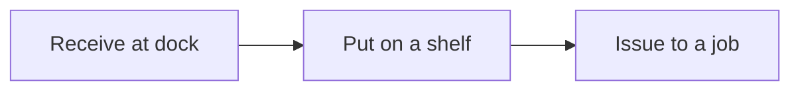

# Stock movements

Every change is one movement: receive, issue, or move. The quantity on a shelf is the sum of its movements.



## Units received this year


| Month | Units |
| --- | --- |
| Jan | 120 |
| Feb | 180 |
| Mar | 160 |
| Apr | 210 |
| May | 190 |
| Jun | 240 |

## Close a receipt

- [x] Match the delivery note to the box labels
- [x] Choose the shelf on the [shelf map](shelves/shelf-map.md)
- [ ] Save the movement

The HTTP call is `POST /movements` in the [items API](../02-platform/openapi.yml).

```bash
curl -X POST http://127.0.0.1:8080/movements \
  -H "Content-Type: application/json" \
  -d "{\"sku\":\"BLT-M8\",\"shelf\":\"A1\",\"qty\":24,\"kind\":\"receive\"}"
```
