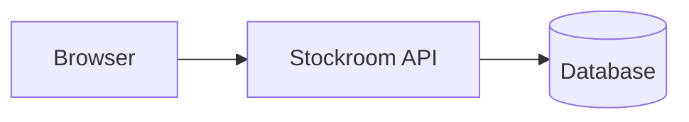

# Architecture
## 12312313## Văn bản
### 1231231

The browser talks only to the API. The API writes movements. The database stores items, shelves, and movements.

- Pages: the list, the receipt form, and the shelf map.
- API: the contract in [openapi.yml](openapi.yml).
- Rules: reorder minimums in [warehouse.yml](warehouse.yml).
- Tables: [schema.sql](schema.sql).

A clerk never edits a quantity by hand except during a [recount](../03-ops/recount.md).
