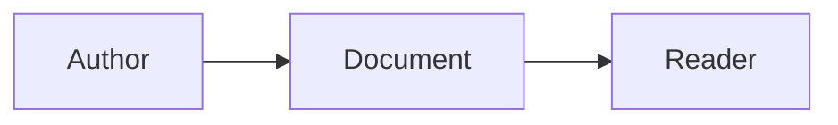

# Writing examples

Copy only the parts you need into a topic under `docs/`, then replace sample content with verified facts.

| Item | Meaning |
| --- | --- |
| Library | The directory containing docs, uploads, history, and db.json |

[API example](openapi.yaml) · [Schema example](schema.sql) · [JSON example](reference.json)

Use the app's upload/insert controls for images and retain the generated media URL.
