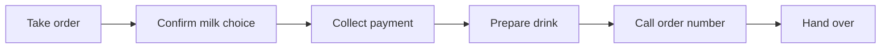

## The flow

## Two people, clear roles
The cashier confirms the drink and milk choice. The barista prepares the drink and calls the order number. Both can read the [latte recipe](../menu/latte.md).

## Media examples
The resource library can play the [order-flow animation](/api/media/cafe0000-0000-4000-8000-000000000005) and the [service chime](/api/media/cafe0000-0000-4000-8000-000000000004). These are synthetic demo media, not recordings of customers.

## App connection
The [sample order](../ordering/order.json) starts as `queued`. The [app overview](../ordering/overview.md) explains the remaining states.
