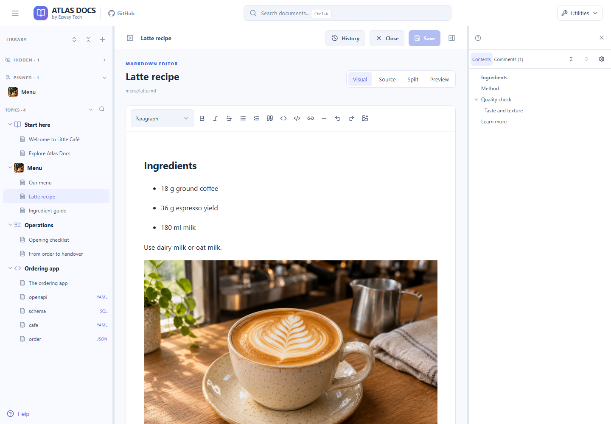

# Atlas Docs

**Keep your project docs organized, readable, and close to your code.**

Atlas Docs is a local documentation library for browsing, editing, and searching project knowledge. Keep guides, API references, database schemas, and attachments together in a browser interface — with the library stored on your own machine.

[Website](https://atlasdocs.ezway.tech/) · [GitHub](https://github.com/ezway-tech/atlas-docs) · [npm](https://www.npmjs.com/package/atlas-docs) · [Donate](https://atlasdocs.ezway.tech/donate/)


*The Example project (Little Café content). Fixed single-library Compose starts with an empty `/data` volume.*

## Features

- Read and write Markdown with Visual, Source, Split, and Preview modes
- Mermaid diagrams, OpenAPI and SQL schema viewers, plus YAML and JSON source views
- Search documents and comments, browse folders, pin favorites, and use a table of contents
- Comments, attachments, and revision history saved through the app
- Light and dark themes, customizable keyboard shortcuts, and UI languages: English, Vietnamese, Simplified Chinese, Spanish, and Japanese



## Get started

No source checkout or local Node.js install is required. You only need Docker with Docker Compose.

Save the following as `compose.yaml` (or copy [`docker-compose.hub.yml`](https://github.com/ezway-tech/atlas-docs/blob/main/docker-compose.hub.yml) from the repository):

```yaml
services:
  atlas-docs:
    image: ezwaytechvn/atlas-docs:5.4.0
    ports:
      - "127.0.0.1:${ATLAS_DOCS_PORT:-17430}:3000"
    environment:
      DATA_DIR: /data
      NODE_ENV: production
      ATLAS_DOCS_UPGRADE_BACKUP_DIR: /upgrade-backups
    volumes:
      - atlas-docs-data:/data
      - atlas-docs-upgrade-backups:/upgrade-backups
    restart: unless-stopped

volumes:
  atlas-docs-data:
  atlas-docs-upgrade-backups:
```

Start:

```sh
docker compose up -d
```

Open **http://127.0.0.1:17430**. Override the host port with `ATLAS_DOCS_PORT`. Pin a release with `ATLAS_DOCS_VERSION` when using the repository Compose file.

> **Local use:** Atlas Docs does not provide authentication for its write API. Keep the localhost port binding shown above; do not expose the app directly to the internet or an untrusted network.

### Different host port

Create a `.env` next to `compose.yaml`:

```dotenv
ATLAS_DOCS_PORT=17431
```

Run `docker compose up -d` again, then open **http://127.0.0.1:17431**. The container listen port remains `3000`.

### Multi-library (opt-in)

For several libraries in one container, use [`docker-compose.hub.multi.yml`](https://github.com/ezway-tech/atlas-docs/blob/main/docker-compose.hub.multi.yml) from the repository (`/libraries` + `/atlas-registry`). Browse and create only within mounted allowed roots.

## Your library stays with you

- **`/data`** stores documents, attachments, comments, settings, and revision history (single-library Compose).
- **`/upgrade-backups`** stores full library backups created during schema upgrades.
- ZIP export and restore are available in the app under **Utilities → Backup & restore**. Restore requires an empty target library.

Keep both volumes when replacing or updating the container. Do not run `docker compose down -v` unless you intend to delete the library volumes.

On Linux bind mounts, if the app cannot write, `chown` host directories to UID **1000** (the image `node` user).

## Updating

Back up volumes or export a ZIP first. Change the image tag to the release you want (or set `ATLAS_DOCS_VERSION`), then:

```sh
docker compose pull
docker compose up -d
```

Use a version tag such as `5.4.0` for predictable updates, or `latest` to follow the latest published image.

An older image may not support a library upgraded by a newer release. If the library schema changed, rolling back also requires a compatible backup.

Readiness: the image HEALTHCHECK calls `GET /api/health`.

## Learn more

Built-in Help is available from the app (Guides, release notes, version details).

- [Source and documentation](https://github.com/ezway-tech/atlas-docs)
- [Report an issue](https://github.com/ezway-tech/atlas-docs/issues)
- [Image tags](https://hub.docker.com/r/ezwaytechvn/atlas-docs/tags)

Atlas Docs is open-source software released under the **MIT License**.
