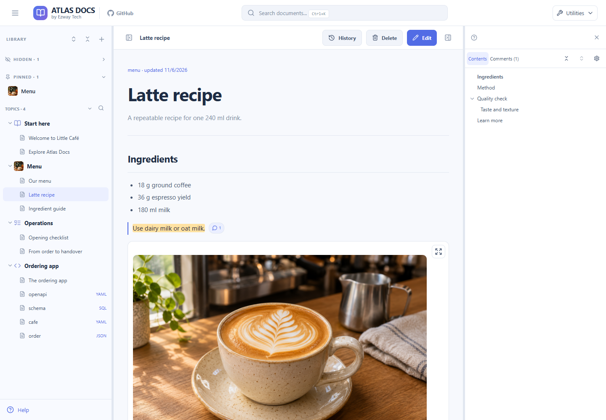
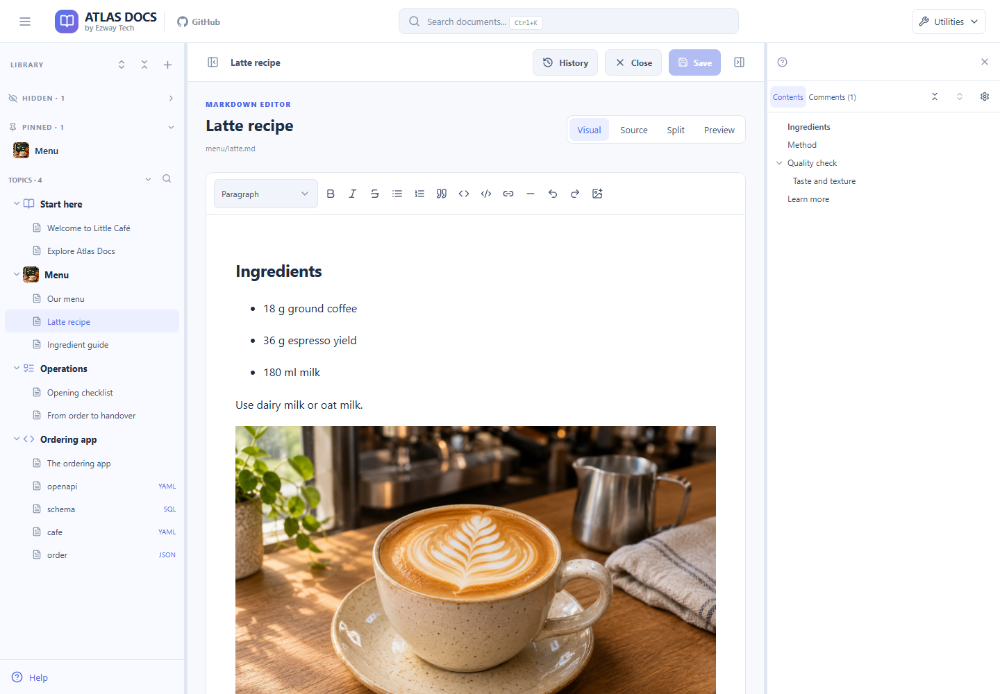
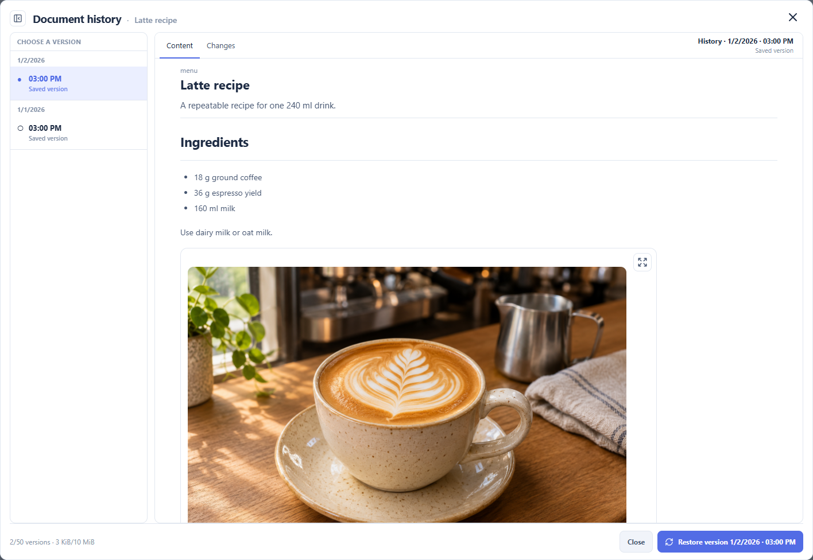

# Atlas Docs

**Keep your project docs organized, readable, and close to your code.**

[](https://www.npmjs.com/package/atlas-docs)
[](https://hub.docker.com/r/ezwaytechvn/atlas-docs)
[](https://github.com/ezway-tech/atlas-docs/blob/main/LICENSE)

[Website](https://atlasdocs.ezway.tech/) · [GitHub](https://github.com/ezway-tech/atlas-docs) · [Docker Hub](https://hub.docker.com/r/ezwaytechvn/atlas-docs) · [Donate](https://atlasdocs.ezway.tech/donate/)

Atlas Docs turns local Markdown, API definitions, and structured files into a browsable project library. Read, edit, search, and connect your documents in one workspace, with images, comments, and revision history alongside the content.



*The Example project (Little Café content). Managed installs open Example or a recent project; new user projects start empty.*

## Quick start (npm)

Requires Node.js 22.12 or newer.

```sh
# Run immediately
npx atlas-docs@latest

# Or install for regular use
npm install -g atlas-docs
atlas-docs

# Check and update
atlas-docs update --check
atlas-docs update

# Installation and library status
atlas-docs doctor
```

`atlas-docs` with no subcommand is the same as `atlas-docs start`. Keep the terminal running; press Ctrl+C to stop.
The first npx run downloads the package and its production dependencies. No source checkout or build is needed.
Offline use works after the package is already installed; update checks never block opening the app.
Default URL: http://127.0.0.1:17430. There is no login on the write API; keep the application local.

## Before an agent generates documents

**Initialize first, write documents second.** Choose the confirmed absolute library path and run:

```sh
npx atlas-docs@latest --data-dir "<absolute-library-path>" --no-open
```

Replace the placeholder; use a missing or empty directory for a new library. Wait for Ready. Atlas creates this structure:

```text
<library>/
  db.json       # Required metadata and schemaVersion; managed by Atlas
  uploads/      # Attachments managed by Atlas
  history/      # Revisions managed by Atlas
  docs/         # Agent writes docs/<folder>/<file>.md here
  AGENTS.md     # Agent entry point, installed when absent
  .atlas/       # Bundled guides matching the installed package
```

Stop with Ctrl+C before bulk external edits. Read the library `AGENTS.md` and `.atlas/guides/agent-guide.md`; put the first document at `docs/overview/getting-started.md`, not directly in `docs/`. Start the same library again and verify it appears.

Do not create `docs/` before initialization or hand-author `db.json`. A nonempty folder without the database is refused; `--yes` does not fix it. Preserve any generated documents and follow the [agent guide](agent-guide.md) for recovery and file rules. `atlas-docs library use` selects a path; it does not initialize storage. Check a specific library with `atlas-docs doctor --data-dir "<absolute-library-path>"`.

For web-only agents, the [public agent guide](https://github.com/ezway-tech/atlas-docs/blob/main/guides/agent-guide.md) and its [raw Markdown](https://raw.githubusercontent.com/ezway-tech/atlas-docs/main/guides/agent-guide.md) are available without a checkout. Prefer bundled guides for your installed version; `main` may be newer.

## What you get

- Browse folders, search documents and comments, pin destinations, and follow a table of contents.
- Markdown with Visual, Source, Split, and Preview editing; Mermaid diagrams; OpenAPI and SQL viewers.
- Attachments, comments, and revision history saved through the app.



*Editing a document in the Little Café sample library.*



*Reviewing an earlier revision in the Little Café sample library.*

## Library location

Each library is a folder (`db.json`, `docs/`, `uploads/`, `history/`). The app process serves one library at a time and holds that library’s lock. You can run several Atlas Docs processes for different libraries on different ports.

Selection order:

1. `--data-dir`
2. Nearest `atlas-docs.config.json` walking up from the current directory
3. Valid recent library from this machine’s registry
4. Existing `./atlas-docs-data` in the current directory (compatibility with earlier versions)
5. Projects screen — one durable Example is prepared automatically; create or open your own project

Relative `--data-dir` values resolve from the calling directory.
`dataDir` inside the config file resolves from the config file's directory.
A broken config or invalid explicit path is an error. A missing or empty `--data-dir` target is initialized; the CLI does not silently substitute another path.
Passing `--data-dir` for one run does not rewrite project config. Opening a library in the UI also does not rewrite project config unless you use an explicit “use for this project” action.

Recent libraries are stored outside any library folder (Windows: `%LOCALAPPDATA%\atlas-docs`, Linux: `$XDG_CONFIG_HOME/atlas-docs` or `~/.config/atlas-docs`). Override with `ATLAS_DOCS_REGISTRY_DIR` (useful in tests and Docker). Remove from list deletes the registry entry only. Delete project folder removes the folder on disk (with safety checks), then the registry entry.

```sh
atlas-docs library use ./project-docs
atlas-docs library info
atlas-docs --data-dir ./project-docs --port 17431 --no-open
atlas-docs start --yes
```

Automation: always pass `--data-dir` when scripts expect a library without the Projects UI. Example for two projects at once:

```sh
atlas-docs --data-dir ./docs-a --port 17430
atlas-docs --data-dir ./docs-b --port 17431
```

`--yes` confirms schema migration without a prompt (required in non-interactive environments).
`--help` and `--version` do not initialize a library.
The server listens only on `127.0.0.1`. Default port is **17430**. If that port is busy and you did not pass `--port`, the CLI tries **17431–17439**, then exits with an error if none are free. With `--port`, a busy port is an error (no auto-fallback). The Ready line prints the URL that is actually listening; the browser opens after the server is ready.

Folder paths chosen in the browser refer to directories on the machine that runs Atlas Docs (the server), which may differ from the device showing the UI.

## Schema and locking

Libraries store an integer `schemaVersion` in `db.json` (currently **1**).
Older libraries without that field are legacy and migrate after confirmation, with a full backup outside the library tree. Override the backup parent with `ATLAS_DOCS_UPGRADE_BACKUP_DIR` when needed (must stay outside the library). If a migration is interrupted, the next confirmed start recovers by restoring that full backup tree, then continues. The env var `ATLAS_TEST_MIGRATE_ABORT` exists only for automated crash tests and must not be set in normal use.
A library with a newer schema than the app is refused; files are not changed.
Only one Atlas Docs process may hold a library lock at a time. External editors are not blocked by that lock.

### Upgrading from 5.1.0

Package **5.1.0** has no `schemaVersion`, no shared prepare gate, and no cross-process library lock. Those protections cannot be applied retroactively to a running 5.1.0 process. After installing 5.2.0 or newer, open the same library once with confirmation (`atlas-docs --yes` when non-interactive) so migration and locking take effect. Keep the upgrade backup until you have verified documents and attachments.

## Connect an agent

Read the [agent guide](agent-guide.md) and [user guide](user-guide.md).
Add this to the source project's own `AGENTS.md`, adjusting the path to your actual library:

```markdown
## Project documentation
Before editing documentation, read ./atlas-docs-data/AGENTS.md
and ./atlas-docs-data/.atlas/guides/agent-guide.md.
Write project documents under ./atlas-docs-data/docs/.
Verify Atlas has created db.json before writing; never invent it.
Verify statements against this project's code and tests.
```

The CLI does not change instructions in other repositories. If the library already has an `AGENTS.md`,
it is preserved. When a managed guide changes, locally edited content is saved under `.atlas/backups/` before replacement.
Unrecognized files are preserved. Agent-kit sync runs only after the library is schema-compatible.
Direct document edits do not create app revision history.

## Updates

In the app, open **Help → Version & updates**. A verified npm global installation managed by the CLI offers **Update and restart**. Save drafts in all windows and confirm. The CLI stops the server, installs the exact new stable version into the same npm prefix, and restarts with the same absolute library path and port. The browser reconnects and reloads after the running version is verified. Restart also permits the normal schema migration with its full backup; the confirmation explains this.

If installation fails, the CLI tries reopening the previous version only when that version is still present. The restarted server must pass its health check. A partly replaced package may need manual recovery: read the error and recovery command in the terminal. If the page has not reconnected after five minutes, it stops waiting and asks you to check the terminal. The updater never edits library files to simulate an update.

The button is unavailable for npx, project dependencies, source checkouts, Docker, an unknown install method, or a server without its CLI supervisor. Use the instructions below for those installations. Version checks also remain usable offline: an unexpired local result can be displayed, while a failed fresh check is reported as unavailable.

Updating the **package** is separate from **schema migration**. Opening a library after an app update may still ask to migrate data; keep the upgrade backup until you have checked documents and attachments.

### npx

1. Stop the running app (Ctrl+C).
2. Back up the library directory (or export a ZIP).
3. Run the same library path with the latest package:

```sh
npx atlas-docs@latest --data-dir "/absolute/path/to/library"
```

Pin a version when you need to stay on a known release:

```sh
npx atlas-docs@6.1.0 --data-dir "/absolute/path/to/library"
```

### Global install

1. Stop the running app.
2. Back up the library.
3. Check and update:

```sh
atlas-docs update --check
atlas-docs update
```

`atlas-docs update` applies an automatic update only when the install method is known and safe (for example npm global with the same prefix). Otherwise it prints the exact command and stops. Then start again with the same library path. Package updates do not migrate every library on the machine; migration happens when that library is opened. Library data is not modified by a failed package update.

### Roll back a package

Installing an older package is safe only when that older app still understands the library `schemaVersion`. If a newer app already migrated the schema, restore the pre-upgrade filesystem backup (or a ZIP taken before migration) instead of only downgrading the package. Updates require an explicit action. In-app restart confirmation permits the normal schema migration with a full backup; CLI migration uses `--yes` or an interactive prompt.

Background update checks use a local cache (at most once per 24 hours); **Check again** bypasses the cache. Disable all registry checks with `ATLAS_DOCS_NO_UPDATE_CHECK=1`. They are off in CI and in development mode. The UI shows a quiet version chip beside the brand (with an optional skip for that version); there is no banner above the workspace. **What's new** opens the GitHub changelog for deciding whether to update. Checks never upload library paths or document contents.

## Backup boundaries

App ZIP backups contain application data: `db.json`, `docs/`, `uploads/`, and `history/`.
They exclude `AGENTS.md` and `.atlas/`. Schema upgrades create a separate full filesystem backup outside the library.
Import into an empty library; generated guides do not prevent import. Backups with a schema newer than the app are refused before the target library changes.

## Source and Docker (different defaults)

All installations use Projects. Source and npm use local project folders; Docker stores projects under mounted `/libraries` and persists its registry separately. `DATA_DIR` and `ATLAS_LIBRARY_MODE=fixed` are obsolete launcher settings; use `--data-dir` for npm or `ATLAS_OPEN_LIBRARY` for source/Docker when selecting an initial project. Switching remains available. See [operations](operations.md).

## Build and release (maintainers)

From a source checkout:

```sh
npm run setup
npm run check:distribution
npm run package:release
npm run test:package
npm run test:upgrade-artifacts
```

Packaging builds one `dist/atlas-docs-<version>.tgz` and `dist/atlas-docs-<version>.tgz.sha256`.
Build, test, and publish from your local machine; this repository has no CI workflow.
The package tests use temporary libraries. The upgrade test also uses the pinned
sanitized 5.1.0 package in `scripts/fixtures/`; keep that directory as a test fixture.
Its checksum differs from the original because build-machine paths were removed.
Packaging and package tests reject artifacts containing personal home paths.
Local tests verify only the operating system on which you run them.

After the checks pass, publish the tarball (replace `<version>` with the version in
`app/package.json`; do not publish the private root or app package):

```sh
npm login
npm view atlas-docs version
npm publish ./dist/atlas-docs-<version>.tgz --access public
```

Then install from the registry into a temporary directory and open a temporary library before tagging the release as done. Docker Hub publishing is separate; see [operations](operations.md#docker-hub-image-end-users).
