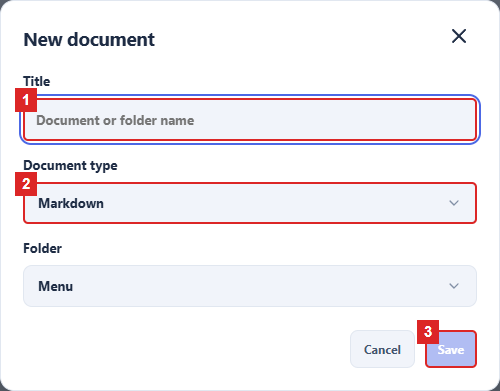
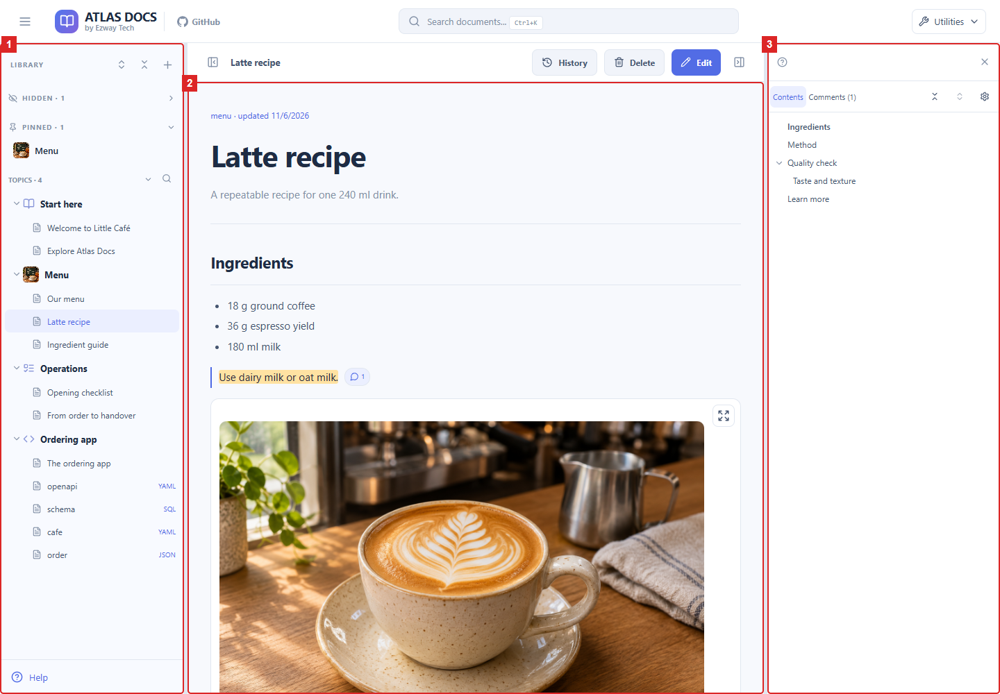
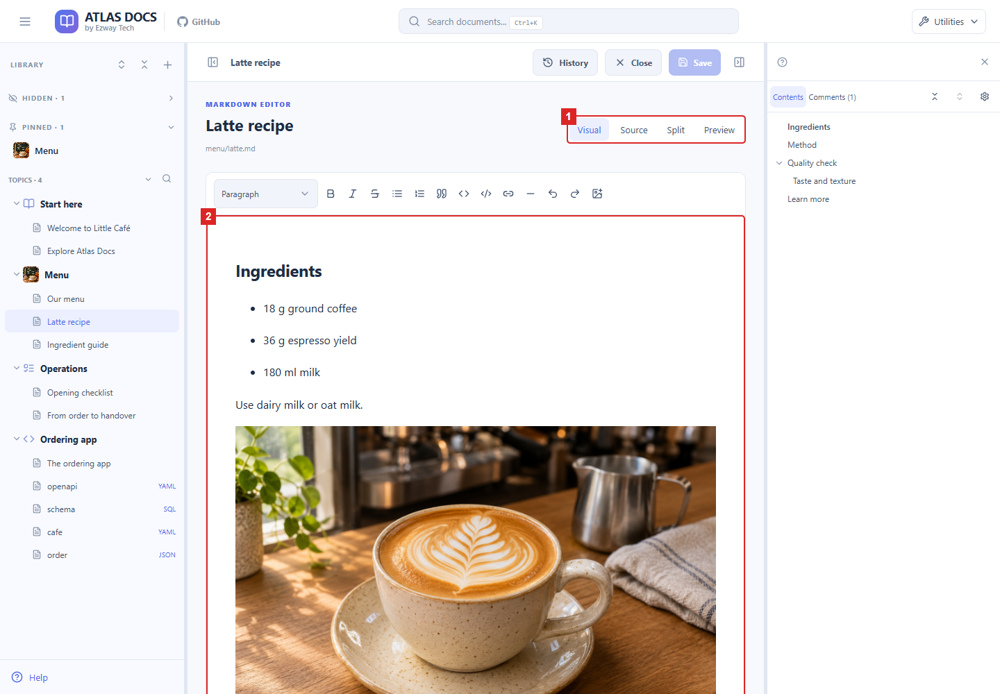
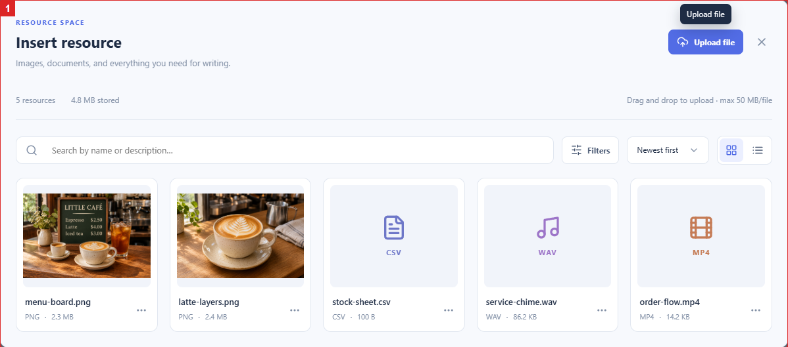
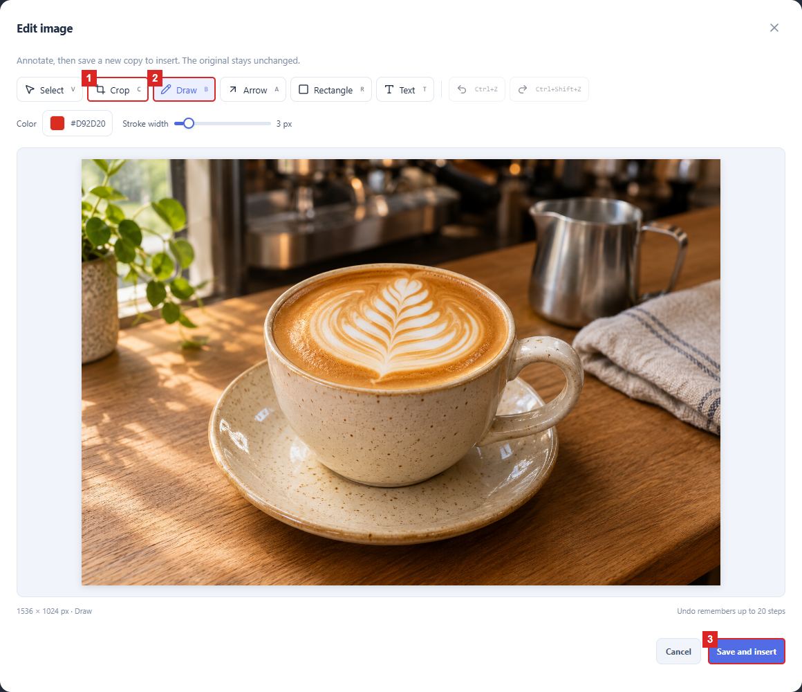
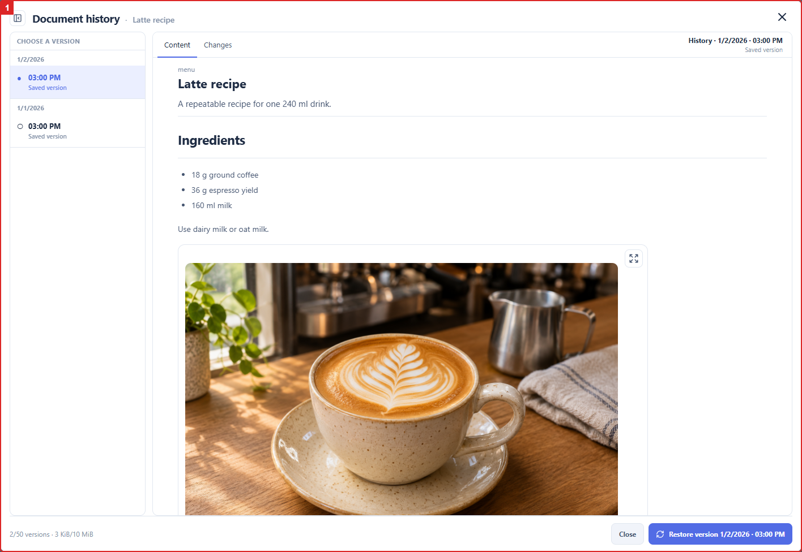
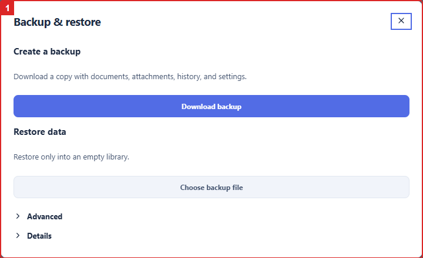
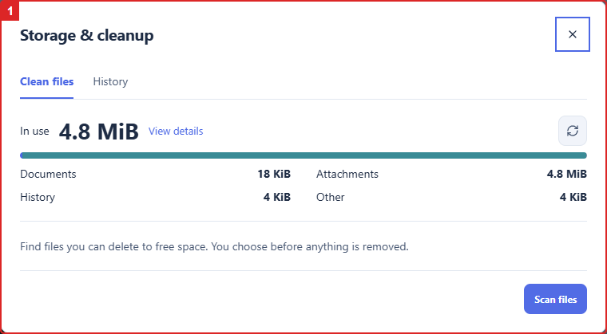

# User guide

[Documentation home](../README.md) · [Agent guide](agent-guide.md) · [Operations](operations.md)

Atlas Docs organizes a local document library. The interface supports Vietnamese, English, Simplified Chinese, Spanish, and Japanese. Choose a language under **Utilities → Language**; the browser stores that choice in a cookie and does not rewrite library files. This guide uses English feature names. Start with the [installation instructions](operations.md#install-and-run) if the app is not running.

## Create your first document

1. Enter the title.
2. Choose the document type; confirm the folder below it.
3. Save the new document.

1. Open the app and create a top-level topic/folder using **New topic**.
2. In that folder's actions, choose **New document**.
3. Enter the **Title**, choose the **document type**, and confirm the **Folder**. Choose Markdown for an ordinary article, then **Save**.
4. Open the document and choose **Edit**. Write a short introduction in Visual or Source, then **Save**.
5. Return to reading and confirm your text appears. Search for its title to find it again.

A library begins empty. To explore prepared content instead, load the optional [Little Café demo](operations.md#optional-little-café-demo) into an empty, separate library. Start at **Start here → Welcome to Little Café → Explore Atlas Docs**. The demo is not required for normal use.

## Organize your library

The numbered outlines locate the library navigation and the reading side panel. Use the tree to open an article, then its contents to jump to a heading.

Use folder actions to create a **Subfolder**, change **Rename / cover**, or choose an icon. The library supports up to three folder levels. Drag siblings to change their order.

Use **Pin** for frequent destinations and **Hide from sidebar** to reduce clutter. Hidden folders remain in the library and can be shown again from the dashboard. Hiding is not access control or deletion. A folder must be empty before it can be deleted.

## Read and navigate

Open a document from the library tree. Use **Contents** to jump to headings. **Contents settings** controls the **From level** and **To level** range. The default is H1–H3; select H6 as the upper level to include deeply nested sections. Saved preferences may change the range.

Follow document links and inspect incoming links to related articles. Open images or diagrams to inspect them at a larger size. Markdown can include tables and Mermaid diagrams; OpenAPI files have an endpoint viewer, SQL files have a schema viewer, and YAML/JSON can be read as source. A displayed API definition does not mean a live API service is supplied.

## Search

Open **Search** to find folders, documents, and comments. Use **Search in folder** from a folder's actions to narrow the scope, then **Search all** to clear it. Use the find-in-document command for the current article.

Default library search is Ctrl+K on Windows/Linux or Command+K on macOS. Shortcuts are customizable; inspect **Utilities → Keyboard shortcuts** for your actual bindings.

## Write and edit

1. Select Visual, Source, Split, or Preview.
2. Edit the content, then use Save in the top toolbar.

Choose **Edit**, then a mode:

| Mode | Use it for |
| --- | --- |
| Visual | Simple prose and supported formatting without editing Markdown syntax |
| Source | Direct Markdown or structured-file editing |
| Split | Source and rendered content together |
| Preview | Inspecting the rendered draft |

Use **Save** to persist your changes. Before closing an edited document, resolve any unsaved-change prompt deliberately.

Visual mode is unavailable for content that may lose syntax during conversion, including detected tables, checklists, Mermaid, SQL/YAML/JSON code blocks, and other complex constructs. Use Source, Split, or Preview for these documents. Switching to a different mode is not a reason to remove useful content.

Use relative links such as `[System overview](../architecture/system-overview.md)` for another document that exists. Use **Insert resource** for registered attachments. The [agent guide](agent-guide.md) explains file-level conventions if you edit outside the app.

## Images and attachments

Open the highlighted resource picker, then select a file to inspect or insert.

1. Crop the image if needed.
2. Draw an annotation.
3. Save and insert the edited copy into the draft.

Open **Utilities → Attachments**. Search files, switch grid/list views, and use **Filters** to narrow by type, source, or usage. Preview images, play supported audio/video, download files, and inspect where a resource is used.

To insert an image while editing, choose **Insert resource**, select or upload the resource, and insert it. Pasting an image opens an image workflow. Save the document after inserting it.

There are two different image-editing outcomes:

- **Edit image** in the resource library overwrites the existing image; references to that resource use the changed image.
- **Draw / edit** from the document insertion flow, followed by **Save and insert**, creates an edited copy and inserts it into the draft.

The image editor includes cropping, drawing, text, and undo/redo. For cropping, select a rectangle and use **Apply crop**. Inspect the result before saving. To remove unused resources, use the cleanup preview described below rather than guessing from filenames.

## Comments and version history

The highlighted history dialog lets you choose a revision and inspect changes before restoring.

Select a passage and add a comment, or use **Write a comment**. Quoted text helps connect the comment to its context. Comments can be edited or deleted through their controls.

Open **History** to inspect revisions and compare changes. Restoring a revision replaces current document content; review the selected revision and resolve any unsaved draft before confirming. A changed save captures the prior content, while an identical save creates no revision.

History is limited, not permanent archival storage. Direct edits on disk do not create app revisions. See [history policy](operations.md#history) for retention and [backup instructions](operations.md#backup-and-restore) for full-library recovery.

## Back up and manage storage

Create a ZIP from the highlighted backup dialog. Restore only into an empty library.

Review storage, then scan files in the highlighted dialog before selecting anything for cleanup.

Open **Utilities → Backup & restore** to export a ZIP. Import accepts an empty library only; use a separate data directory to test recovery. Do not erase the working library just to enable import.

Open **Utilities → Storage & cleanup** to review storage use. Use **Refresh** for fresh statistics, then **Scan files** to preview cleanup candidates. Review each reason, count, and size before confirming deletion. History-only references require deliberate review; unsaved browser drafts are not visible to the cleanup scanner.

For limits, recovery, and failure cases, read [operations](operations.md). Copying only Markdown files does not preserve comments, attachments, or app history.

## Appearance, language, and shortcuts

Use **Utilities** to switch between light and dark appearance, open **Keyboard shortcuts**, and choose **Language**. Language preference is stored in the browser only. Customize bindings in the shortcuts dialog rather than assuming the defaults in this guide still apply. Panel controls let you show or hide navigation and the reading side panel.
