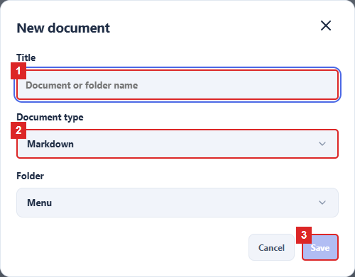
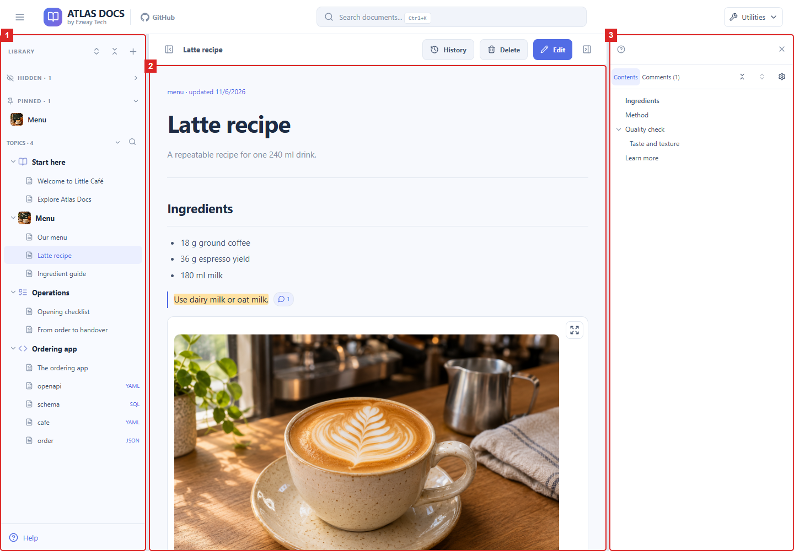
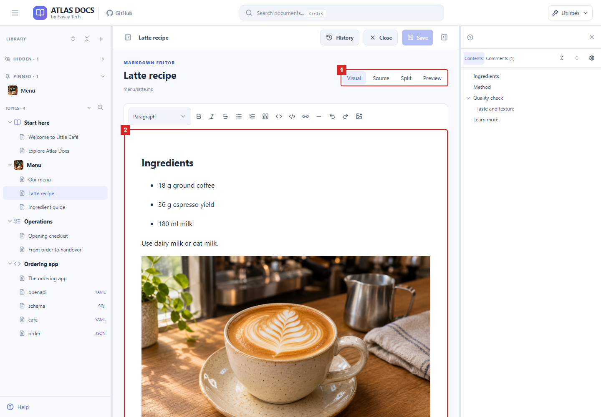
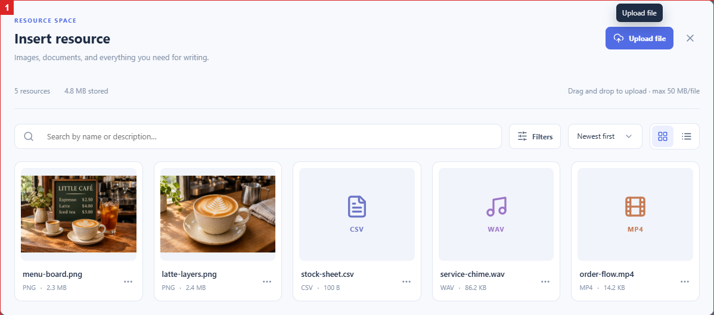
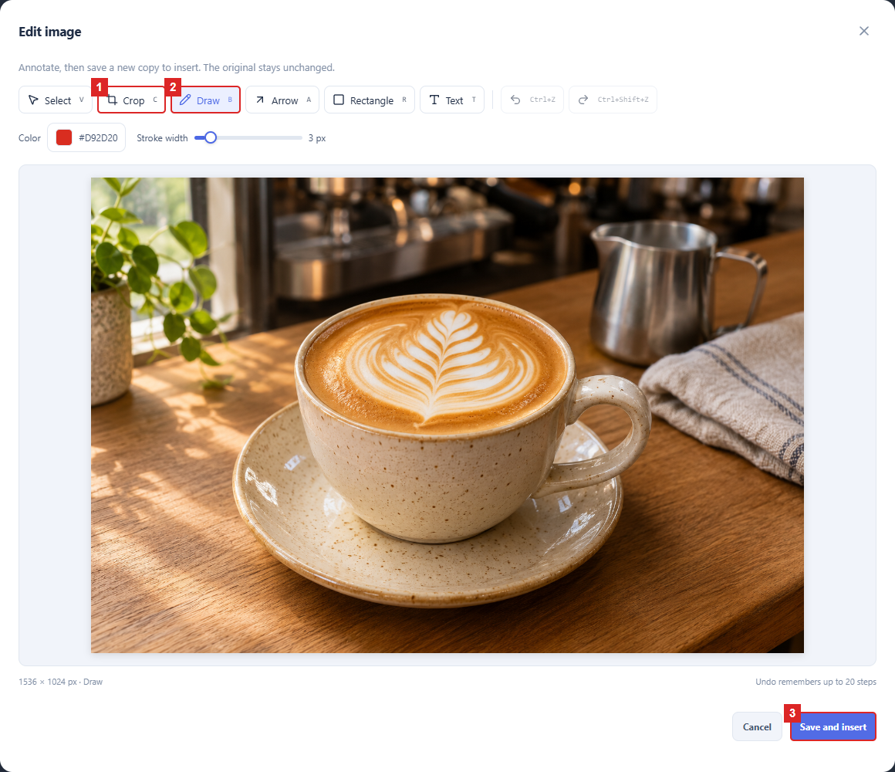
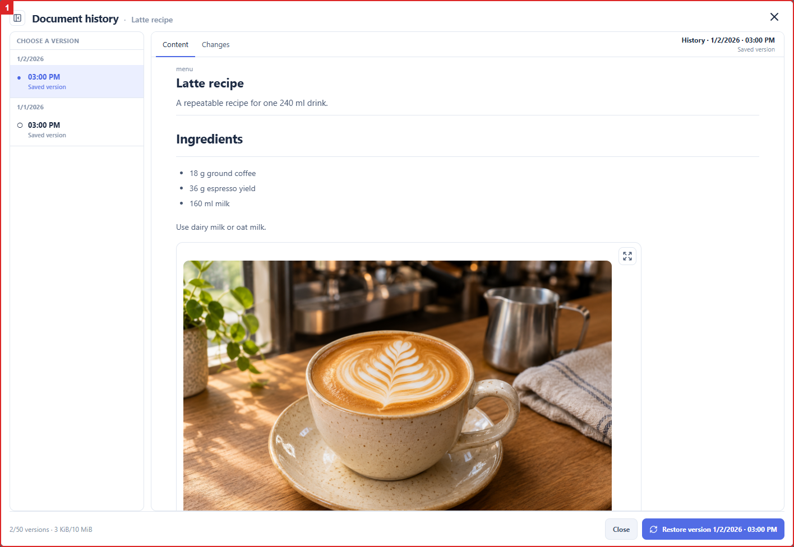
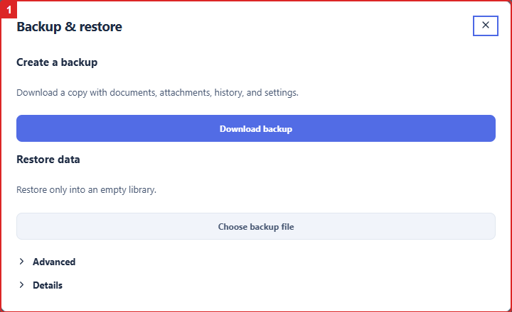
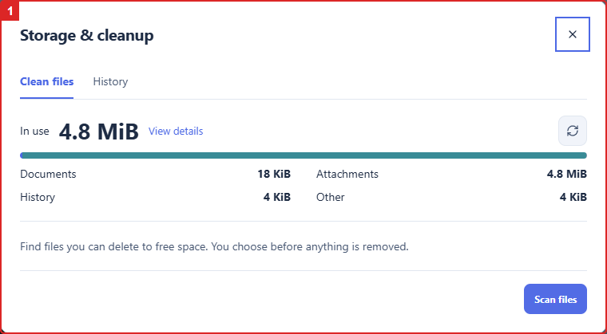

# User guide

[Documentation home](../README.md) · [Agent guide](agent-guide.md) · [Operations](operations.md)

Atlas Docs organizes a local document library. The interface supports Vietnamese, English, Simplified Chinese, Spanish, and Japanese. Choose a language from **Utilities → Language**; the browser stores that choice in a cookie and does not rewrite library files. Light and dark theme also live under **Utilities** on Projects and the workspace (Help keeps its own theme control). This guide uses English feature names. Start with the [installation instructions](operations.md#install-and-run) if the app is not running.

## Manage projects

Each project is one folder that holds `docs/`, `uploads/`, `history/`, and `db.json`. The first launch prepares the sample **Example** project. Later launches prepare your most recent valid project, but you enter the workspace only after choosing a project. The home page opens the separate Projects screen. Select a project to load the workspace. Reloading a workspace or opening a document link keeps that page.

Use the **Project · name** control in the top bar to leave the workspace and open the separate **Projects** page. Unsaved changes must be saved first or discarded through the confirmation dialog. The Projects page uses the same top bar style as the workspace (brand on the left; Help and Utilities on the right). Bundled Help also uses that top bar, with Back to library and theme controls; guide text stays in English. The page uses a list on the left and project details on the right. It shows a project count and a search box for name or path. **Example** is first, then your other projects in the order you set. Drag non-Example rows to rearrange that order (saved on this machine). Select a project to review its path, status, and a short summary (topics, folders, documents, comments, assets, and schema version). Then use **Open project**. Double-click a row also opens it. **Browse for project** uses the operating-system folder dialog on a personal desktop. In Docker or other environments without a local desktop, browse stays inside the storage mounts the app is allowed to see.

**Open project** opens the chosen folder in place. It does not copy files. When **Browse for project** selects a folder that is not already in the list, Atlas asks for a display name (suggested from the folder name) before opening or creating the project. An empty folder can become a new project after you confirm that name. A folder that has other files but is not an Atlas Docs project is explained and left unchanged. Folders already in the list open with their existing display name. **Create project** asks for a name and save location, then creates a new project folder.

**Missing locations (N)** stays as one summary line below the list. Select **Manage** to open a compact, scrollable dialog with search by name or path. Each row has a menu to **Choose location again** or **Remove from list** (with confirmation). **Remove all missing entries** asks for confirmation and only removes missing entries from the list. Removing from the list does not delete files on disk. If Example cannot be prepared, its row shows an unavailable status and error details.

Each project's menu contains **Open in Explorer** and **Copy path**, with rename, **Remove from list**, and **Delete project folder** for your registered projects (not Example, and not the project open in this session). Both remove and delete ask for confirmation. **Remove from list** only updates the registry. **Delete project folder** permanently deletes that folder on disk, then removes the registry entry. **Open in Explorer** reveals that project in the local file manager on desktop launches. All supported installations use Projects and allow switching. Docker persists projects under `/libraries`, with a separate persistent registry and upgrade-backup volume.

## Create your first document

1. Enter the title.
2. Choose the document type; confirm the folder below it.
3. Save the new document.

1. Open the app and create a top-level topic/folder using **New topic**.
2. In that folder's actions, choose **New document**.
3. Enter the **Title**, choose the **document type**, and confirm the **Folder**. Choose Markdown for an ordinary article, then **Save**.
4. Open the document and choose **Edit**. Write a short introduction in Visual or Source, then **Save**.
5. Return to reading and confirm your text appears. Search for its title to find it again.

New projects begin empty. The built-in **Example** project already includes the sample Little Café documents. Start at **Start here → Welcome to Little Café → Explore Atlas Docs**. Your own projects and Example do not overwrite each other.

## Projects

Atlas Docs keeps the app separate from your data. Each project is a folder you choose. One running app serves one project and holds its lock. Use the project name in the top bar to open the project manager, switch projects, rename a display name, remove an entry from the list (files on disk are not deleted), or delete a project folder from disk after confirmation.

Opening a project from the UI does not rewrite `atlas-docs.config.json`. Project-aware CLI users still bind a path with `atlas-docs library use`.

For two projects at once, start two CLI processes with different `--data-dir` and `--port` values. See [npm usage](npm.md#library-location).

## Organize your library

The numbered outlines locate the library navigation and the reading side panel. Use the tree to open an article, then its contents to jump to a heading.

Use folder actions to create a **Subfolder**, change **Rename / cover**, or choose an icon. The library supports up to three folder levels. Drag sibling **folders** or **documents** in the library tree to change their order (saved in the project). Drag the right-panel tabs (**Contents** / **Comments**) to reorder them on this browser. You can also drag the sidebar section headers (Hidden / Pinned / Topics) and items in the Pinned or Hidden lists.

Use **Pin** for frequent destinations and **Hide from sidebar** to reduce clutter. Hidden folders remain in the library and can be shown again from the dashboard. Hiding is not access control or deletion. A folder must be empty before it can be deleted.

## Read and navigate

Open **Help** in the top bar for **Guides**, **Release notes**, **Version & updates**, and **Support the project**. Guides, release notes, and support open a new tab, so your current draft stays open. Support is no longer in the library sidebar.

The Atlas Docs logo opens the [project website](https://atlasdocs.ezway.tech/). To support development, open **Help → Support the project** or visit the [donation page](https://atlasdocs.ezway.tech/donate/).

The running version appears next to the Atlas Docs brand. When a newer stable version is available, that chip highlights lightly. Open it (or **Help → Version & updates**) to update, open **What's new** on GitHub for the latest release notes, or choose **Skip this version** to hide the highlight until a newer release appears. Local **Help → Release notes** shows the changelog bundled with the version you already run. Development mode shows **Development** and does not check for updates. A failed check is shown as unavailable, not as up to date.

A verified global npm installation started by the Atlas Docs CLI can use **Update and restart**. Save or discard drafts first, confirm the restart, and wait for the page to reconnect. Other installation methods show a command or the relevant [update instructions](operations.md#update-an-installation).

Open a document from the library tree. Use **Contents** to jump to headings. **Contents settings** controls the **From level** and **To level** range. The default is H1–H3; select H6 as the upper level to include deeply nested sections. Saved preferences may change the range.

Follow document links and inspect incoming links to related articles. Open images or diagrams to inspect them at a larger size. Markdown can include tables and Mermaid diagrams; OpenAPI files have an endpoint viewer, SQL files have a schema viewer, and YAML/JSON can be read as source. A displayed API definition does not mean a live API service is supplied.

## Search

Open **Search** to find folders, documents, and comments. Use **Search in folder** from a folder's actions to narrow the scope, then **Search all** to clear it. Use the find-in-document command for the current article.

Default library search is Ctrl+K on Windows/Linux or Command+K on macOS. Shortcuts are customizable; inspect **Utilities → Keyboard shortcuts** for your actual bindings.

## Write and edit

1. Select Visual, Source, Split, or Preview.
2. Edit the content, then use Save in the top toolbar.

Choose **Edit**, then a mode:

| Mode | Use it for |
| --- | --- |
| Visual | Simple prose and supported formatting without editing Markdown syntax |
| Source | Direct Markdown or structured-file editing |
| Split | Source and rendered content together |
| Preview | Inspecting the rendered draft |

Use **Save** to persist your changes. Before closing an edited document, resolve any unsaved-change prompt deliberately.

Visual mode is unavailable for content that may lose syntax during conversion, including detected tables, checklists, Mermaid, SQL/YAML/JSON code blocks, and other complex constructs. Use Source, Split, or Preview for these documents. Switching to a different mode is not a reason to remove useful content.

Use relative links such as `[System overview](../architecture/system-overview.md)` for another document that exists. Use **Insert resource** for registered attachments. The [agent guide](agent-guide.md) explains file-level conventions if you edit outside the app.

## Images and attachments

Open the highlighted resource picker, then select a file to inspect or insert.

1. Crop the image if needed.
2. Draw an annotation.
3. Save and insert the edited copy into the draft.

Open **Utilities → Attachments**. Search files, switch grid/list views, and use **Filters** to narrow by type, source, or usage. Choose **Custom order** to drag files into a saved sequence used by the library and pickers. Preview images, play supported audio/video, download files, and inspect where a resource is used.

To insert an image while editing, choose **Insert resource**, select or upload the resource, and insert it. Pasting an image opens an image workflow. Save the document after inserting it.

There are two different image-editing outcomes:

- **Edit image** in the resource library overwrites the existing image; references to that resource use the changed image.
- **Draw / edit** from the document insertion flow, followed by **Save and insert**, creates an edited copy and inserts it into the draft.

The image editor includes cropping, drawing, text, and undo/redo. For cropping, select a rectangle and use **Apply crop**. Inspect the result before saving. To remove unused resources, use the cleanup preview described below rather than guessing from filenames.

## Comments and version history

The highlighted history dialog lets you choose a revision and inspect changes before restoring.

Select a passage and add a comment, or use **Write a comment**. Quoted text helps connect the comment to its context. Comments can be edited or deleted through their controls.

Open **History** to inspect revisions and compare changes. Restoring a revision replaces current document content; review the selected revision and resolve any unsaved draft before confirming. A changed save captures the prior content, while an identical save creates no revision.

History is limited, not permanent archival storage. Direct edits on disk do not create app revisions. See [history policy](operations.md#history) for retention and [backup instructions](operations.md#backup-and-restore) for full-library recovery.

## Back up and manage storage

Create a ZIP from the highlighted backup dialog. Restore only into an empty library.

Review storage, then scan files in the highlighted dialog before selecting anything for cleanup.

Open **Utilities → Backup & restore** to export a ZIP. Import accepts an empty library only; use a separate data directory to test recovery. Do not erase the working library just to enable import.

Open **Utilities → Storage & cleanup** to review storage use. Use **Refresh** for fresh statistics, then **Scan files** to preview cleanup candidates. Review each reason, count, and size before confirming deletion. History-only references require deliberate review; unsaved browser drafts are not visible to the cleanup scanner.

For limits, recovery, and failure cases, read [operations](operations.md). Copying only Markdown files does not preserve comments, attachments, or app history.

## Appearance, language, and shortcuts

Use **Utilities** to switch between light and dark appearance, open **Keyboard shortcuts**, and choose **Language**. Language preference is stored in the browser only. Customize bindings in the shortcuts dialog rather than assuming the defaults in this guide still apply. Panel controls let you show or hide navigation and the reading side panel.
